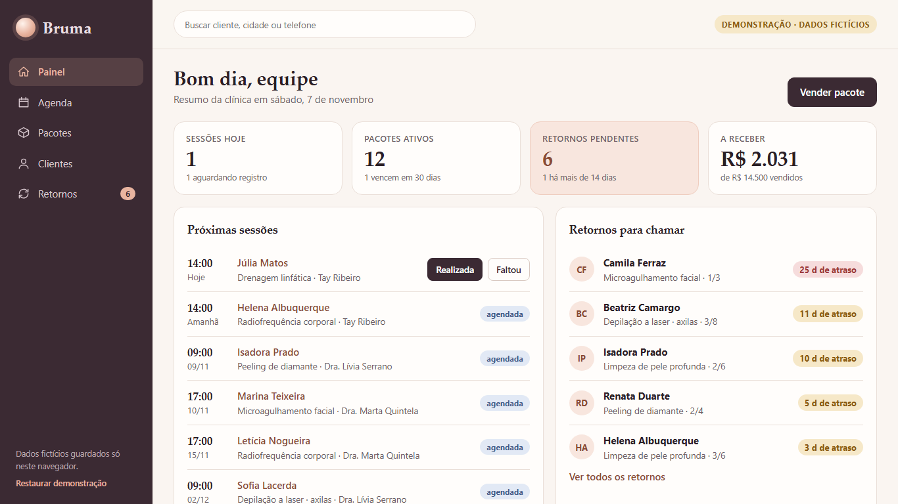
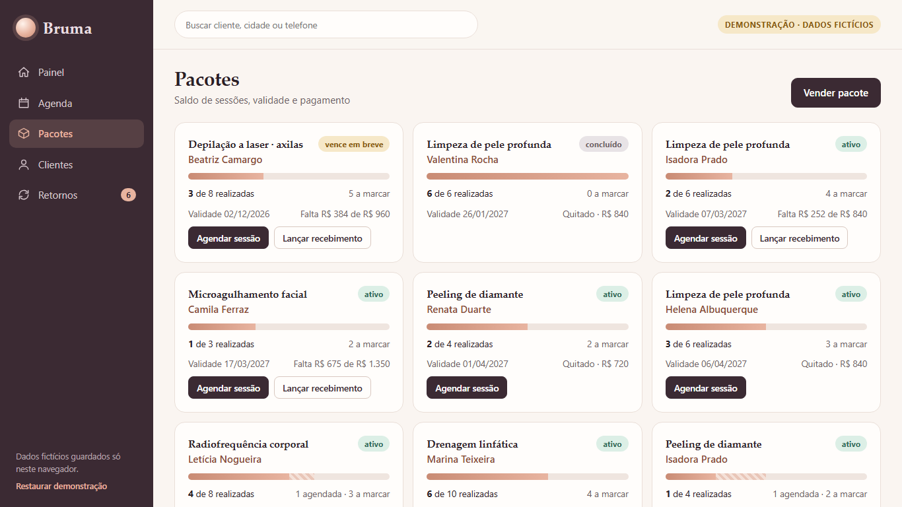
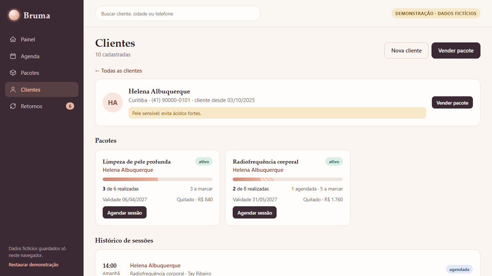
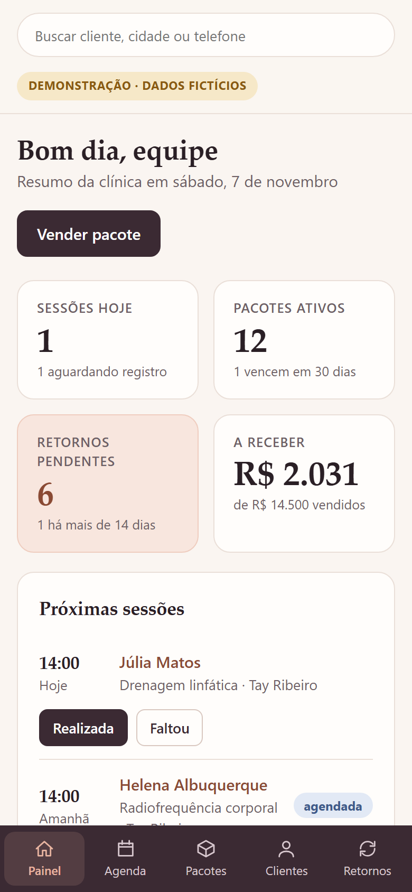

# Bruma Estética — aesthetic clinic CRM (demo)

A front-end CRM for a **fictional** aesthetic clinic, built around what a clinic actually sells: **treatment packages**. It tracks sessions left on each package, the schedule, payments, and — the part that makes money — **who is overdue to come back**.

**Live demo:** https://alissonlittig.github.io/bruma-estetica/

> All names, phones and values are made up. Data lives only in your browser (`localStorage`); nothing is sent anywhere. Use *Restore demo* in the sidebar to reset.

| Dashboard | Packages |
|---|---|
|  |  |

| Client record | Mobile (390 px) |
|---|---|
|  |  |

## What it does

- **Packages** — each sale has N sessions, a validity window and a payment balance. Progress bar separates *done* from *booked*; status is derived (`active`, `expires soon`, `expired`, `completed`).
- **Sessions** — book from a package (blocked outside validity or when no balance is left), then mark as done or no-show; the balance updates immediately.
- **Return radar** — a package with balance, inside validity and with nothing booked becomes a *return* once `last session + protocol interval` passes. Marking "contact made" silences it until the next due date.
- **Clients** — search, record with clinical notes, packages and full session history.
- **Dashboard** — sessions today, active packages, pending returns, receivables.
- Responsive: sidebar on desktop, bottom tab bar at 390 px; keyboard accessible, skip link, reduced-motion respected.

## Stack

Preact 10 · TypeScript · Vite · Vitest. No runtime dependencies besides Preact (~12 kB gzipped JS). Business rules live in `src/lib.ts` (pure functions, covered by `src/lib.test.ts`).

## Run it

```bash
npm ci
npm test        # unit tests for package/return rules
npm run build   # type-check + production build into dist/
npm run dev
```

CI (`.github/workflows`) runs tests and build on every push and deploys `main` to GitHub Pages.

Lighthouse (mobile profile, production build): Performance 91 · Accessibility 100 · Best Practices 100 · SEO 92.

## Notes

Portfolio demo project. Dates in the seed data are generated relative to "today", so the dashboard always looks alive.
